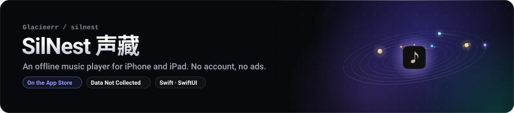
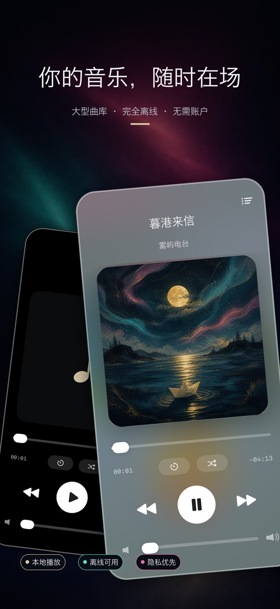
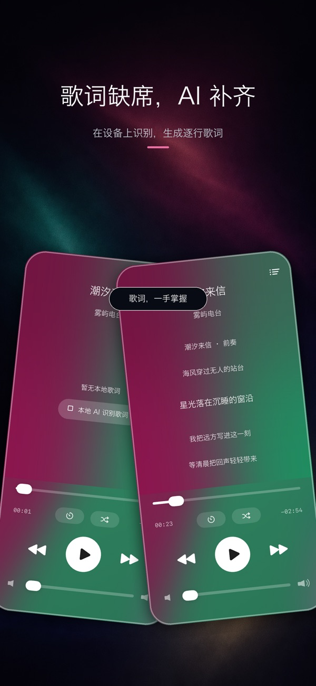
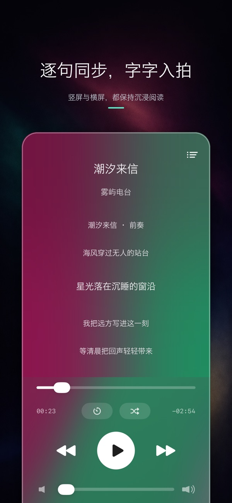
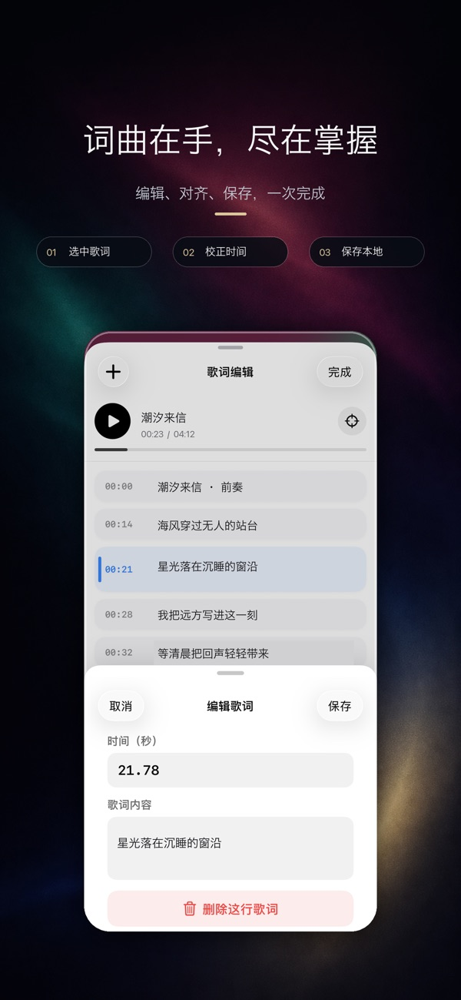

<picture>
  <source media="(prefers-color-scheme: light)" srcset="assets/header-light.svg">
  
</picture>

**Your music, always with you, offline.** An offline local-music player for iPhone and iPad.

https://apps.apple.com/app/id6796483224

[English](#english) | [中文](#中文)

## English

SilNest is a player for the music already on your device. It needs no account and shows no ads, and it works fully offline.

  
  
  
  

### Features

- **Offline.** Browse and play the music saved on your device without a network connection.
- **No account, no ads.** Open the app and use it.
- **Built for large libraries.** Search by song name, with an A-Z, 0-9 and # index.
- **On-device AI lyrics.** When a song has no lyrics, speech recognition runs on the device (using [whisper.cpp](https://github.com/ggml-org/whisper.cpp)) to generate them, with line-by-line synced highlighting. Results depend on device performance, audio quality, language and song length.
- **Lyric editor.** Edit lyric text and correct each line's timing.
- **Your audio files are never modified.** Edited lyrics are saved separately from the audio.
- **Landscape layout** that rearranges artwork, lyrics and controls, and an edge swipe from either side to open the playlist.

### Privacy

The App Store privacy label is **Data Not Collected**. In short (see the full policy for details): no account, no developer-operated server, no ads, no analytics SDKs, no tracking. Your music and transcription results stay on your device.

### Requirements

- iPhone and iPad
- iOS 17.0 or later
- Free

### Links

- [App Store page](https://apps.apple.com/app/id6796483224)
- [App website](https://yecanyuan.com/apps/silnest/)
- [Support](https://yecanyuan.com/apps/silnest/support/)
- [Privacy policy](https://yecanyuan.com/apps/silnest/privacy/)

### Built with

Swift and SwiftUI, AVFoundation for playback, and [whisper.cpp](https://github.com/ggml-org/whisper.cpp) (through SwiftWhisper) for the on-device lyrics.

### About this repository

The source code of SilNest is private. This repository is only an introduction page, so there is nothing to build or run here.

By Canyuan Ye.

<!-- License (R3.3 #162): not chosen yet. The app is not open source and the icon and screenshots are its own artwork,
     so the suggestion is to add no open-source license here (all rights reserved). If you decide otherwise, add LICENSE and a section here. -->

---

## 中文

**声藏 · SilNest** 是一款专注本地音乐的离线播放器，适用于 iPhone 和 iPad。无需账户，没有广告，不联网也能使用。

  

App Store 链接：https://apps.apple.com/app/id6796483224

### 功能

- **完全离线**：保存在设备上的音乐，无需网络即可浏览和播放。
- **无需账户，没有广告**，打开即用。
- **面向大型本地曲库**：按歌曲名称搜索，支持 A-Z、0-9 与 # 字符索引。
- **设备端 AI 歌词**：歌曲没有歌词时，在设备上使用 AI 识别并生成歌词（基于 whisper.cpp），支持逐行同步高亮。识别效果与处理时间取决于设备性能、音频质量、歌曲语言和时长。
- **歌词编辑**：编辑歌词内容，校正每行歌词的显示时间。
- **不修改你的音频文件**：编辑后的歌词单独保存，不会改动原始音频。
- 横屏自动重排封面、歌词与播放控件；从屏幕任意一侧向内滑动即可进入播放列表。

### 隐私

App Store 隐私标签为“未收集数据”（Data Not Collected）。简要来说：无账户、无开发者自有服务器、无广告、无分析 SDK、无跟踪。音乐和识别结果都留在你的设备上。详情见隐私政策。

### 系统要求

- iPhone 和 iPad
- iOS 17.0 及以上
- 免费

### 链接

- [App Store 页面](https://apps.apple.com/app/id6796483224)
- [应用网站](https://yecanyuan.com/apps/silnest/)
- [技术支持](https://yecanyuan.com/apps/silnest/support/)
- [隐私政策](https://yecanyuan.com/apps/silnest/privacy/)

### 技术

Swift、SwiftUI，播放用 AVFoundation；设备端歌词识别用 [whisper.cpp](https://github.com/ggml-org/whisper.cpp)（通过 SwiftWhisper）。

### 关于本仓库

声藏的源代码不公开。本仓库仅作为介绍页，没有可以构建或运行的内容。

作者：叶璨源（Canyuan Ye）
